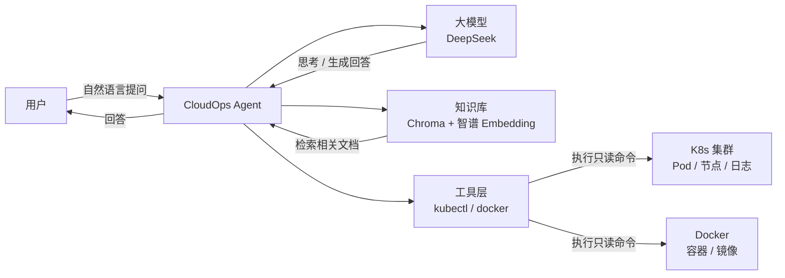
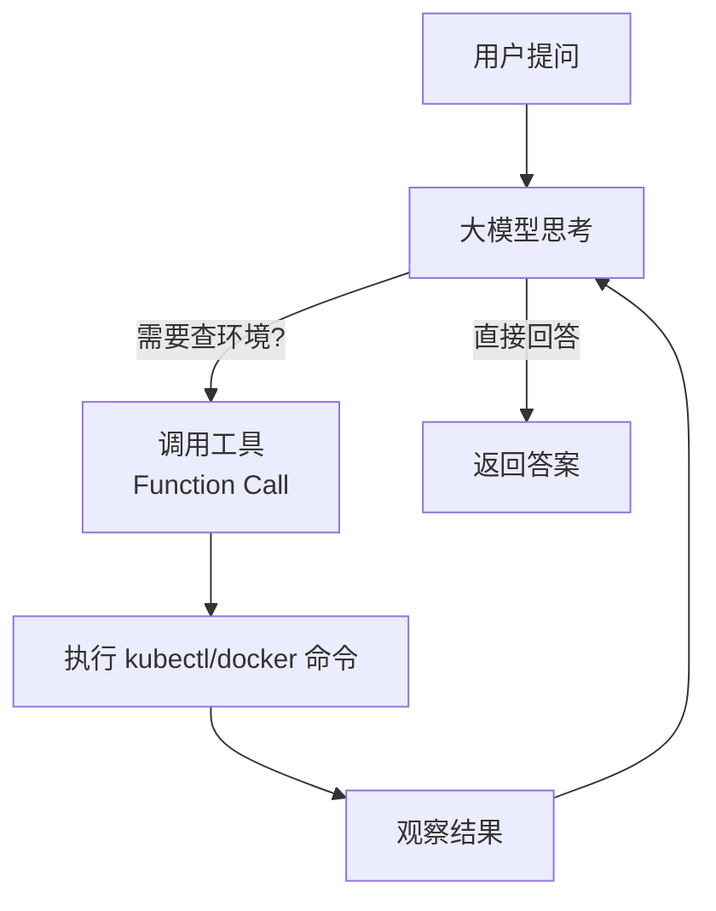
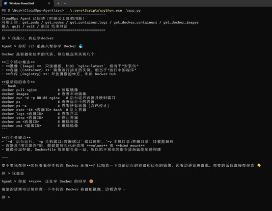
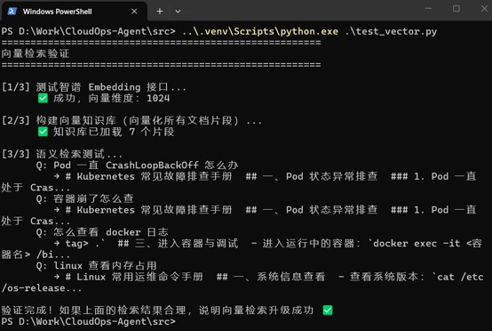
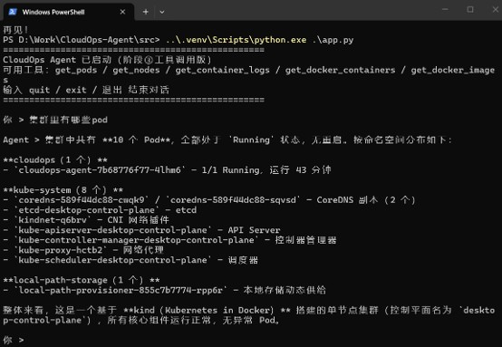
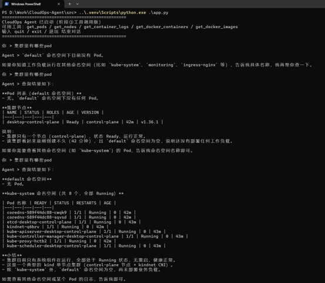
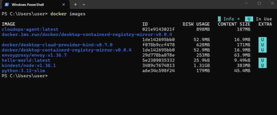
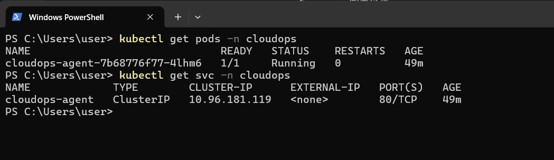
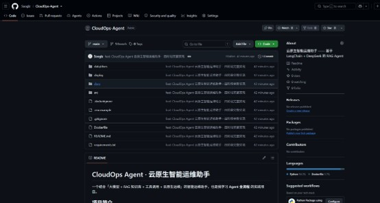
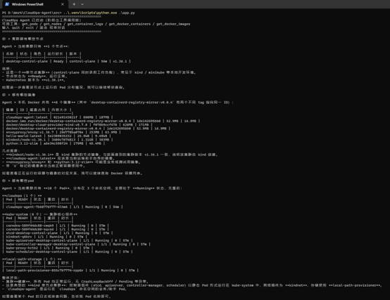

# CloudOps Agent · 云原生智能运维助手

一个结合「大模型 + RAG 知识库 + 工具调用 + 云原生运维」的智能运维助手，也是我学习 **Agent 全流程** 的实践项目。

## 项目简介

能用自然语言对话，帮你查询、诊断 Linux / Docker / Kubernetes 环境的 AI 运维助手。

**技术栈**：Python 3.12 · LangChain · DeepSeek（OpenAI 兼容接口）· Chroma · 智谱 Embedding · Docker · Kubernetes

## 系统架构



Agent 的「思考 → 调用工具 → 观察结果 → 再思考」循环（ReAct）：



## 当前进度

- [x] 阶段①：最小可运行的对话 Agent（多轮记忆）
- [x] 阶段②：接入 RAG 知识库（关键词检索 → 已升级向量检索）
- [x] 阶段③：接入工具调用（ReAct 循环，模拟工具 → 已升级真实命令）
- [x] 阶段④：容器化部署到 K8s（Docker 镜像构建 + K8s 部署，已实跑通过）

## 运行截图

| 截图 | 说明 |
|------|------|
|  | 多轮对话与记忆 |
|  | RAG 向量检索（问「容器崩了」命中「CrashLoopBackOff」） |
|  | 真实工具调用（Agent 查询到 K8s 集群中的 Pod） |
|  | 工具调用改进前（默认只查 default 命名空间） |
|  | 构建好的 CloudOps Agent 镜像 |
|  | 部署到 Kubernetes 集群 |
|  | 项目仓库首页 |
|  | 压轴演示：Agent 查询真实 K8s 集群节点与全部 Pod 状态 |

> 完整的技术难点复盘见 [docs/踩坑复盘笔记.md](docs/踩坑复盘笔记.md)。

## 快速开始

### 1. 安装依赖

```bash
pip install -r requirements.txt
```

### 2. 配置 API Key

```bash
# 复制环境变量模板，填入你的 DeepSeek / 智谱 API Key
cp .env.example .env
```

`.env` 需要配置：

```
DEEPSEEK_API_KEY=sk-你的key        # 大模型（对话+工具调用）
ZHIPU_API_KEY=你的key              # Embedding（向量检索）
```

### 3. 运行（本地命令行）

```bash
python src/app.py
```

### 4. 容器化运行（阶段④）

```bash
# 构建镜像
docker build -t cloudops-agent:latest .
# 运行
docker run -it --rm --env-file .env cloudops-agent:latest
```

### 5. 部署到 K8s（阶段④）

```bash
# 先替换 deploy/cloudops-agent.yaml 里 Secret 的 API Key，然后：
kubectl apply -f deploy/cloudops-agent.yaml
```

## 项目结构

```
CloudOps-Agent/
├── src/
│   ├── app.py             # 主入口（RAG + 工具调用完整版）
│   ├── agent.py           # ToolCallingAgent（ReAct 循环）
│   ├── tools.py           # 工具层（真实命令 + 模拟降级）
│   ├── rag.py             # RAG 链路（Keyword/Vector 检索器）
│   ├── embedding.py       # 智谱 Embedding 封装
│   ├── build_kb.py        # 知识库构建/调试
│   └── test_vector.py     # 向量检索验证脚本
├── data/
│   └── docs/              # 知识库文档（K8s/Docker/Linux 手册）
├── docs/                  # 各阶段说明 + 项目规划
├── screenshots/           # 运行截图（作品集素材）
├── deploy/
│   └── cloudops-agent.yaml  # K8s 部署清单
├── Dockerfile             # 镜像构建定义
├── .dockerignore          # 构建忽略清单
├── requirements.txt       # 依赖清单
├── .env.example           # 环境变量模板
└── README.md
```

## 四阶段学习路线

| 阶段 | 内容 | 学会的 Agent 核心概念 |
|------|------|----------------------|
| ① 最小 Agent | 对话脚本 | Prompt、多轮记忆 |
| ② RAG | 知识库检索增强 | Embedding、向量检索、语义匹配 |
| ③ 工具调用 | ReAct 循环 | Function Call、思考-行动-观察 |
| ④ 容器化 | Docker + K8s | 镜像、编排、Secret |

## 学习笔记

- `docs/项目规划.md`：完整项目规划与路线
- `docs/阶段②RAG说明.md`：RAG 设计与向量检索升级
- `docs/阶段③工具调用说明.md`：工具调用机制与 ReAct
- `docs/阶段④容器化部署说明.md`：Dockerfile / K8s / 真实工具
- `docs/踩坑复盘笔记.md`：技术难点复盘（面试加分项）
- `docs/面试问答手册.md`：高频面试问题及答案
- `docs/作品集总览.md`：作品集素材入口
